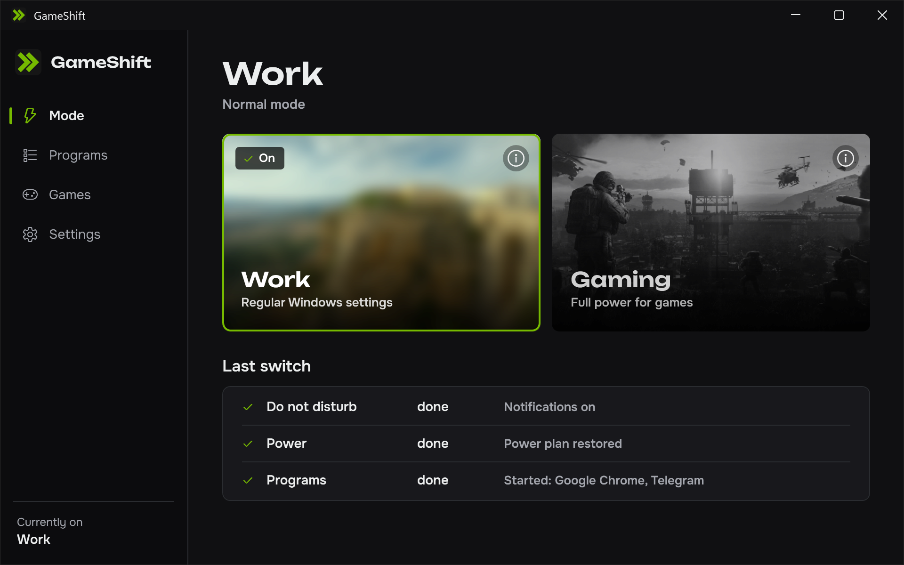
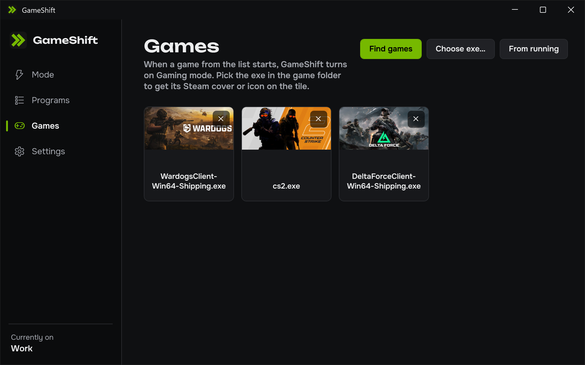
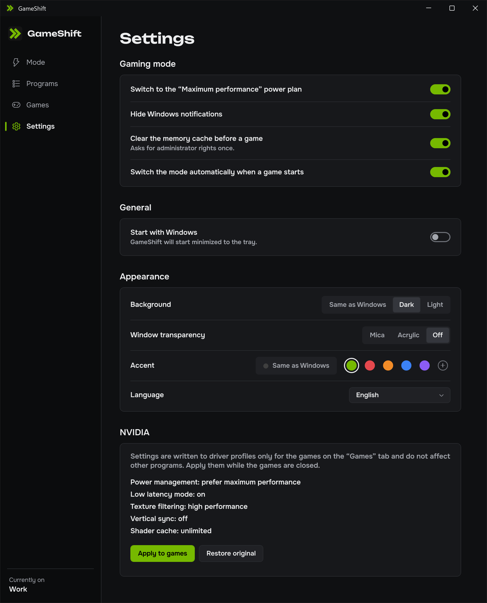
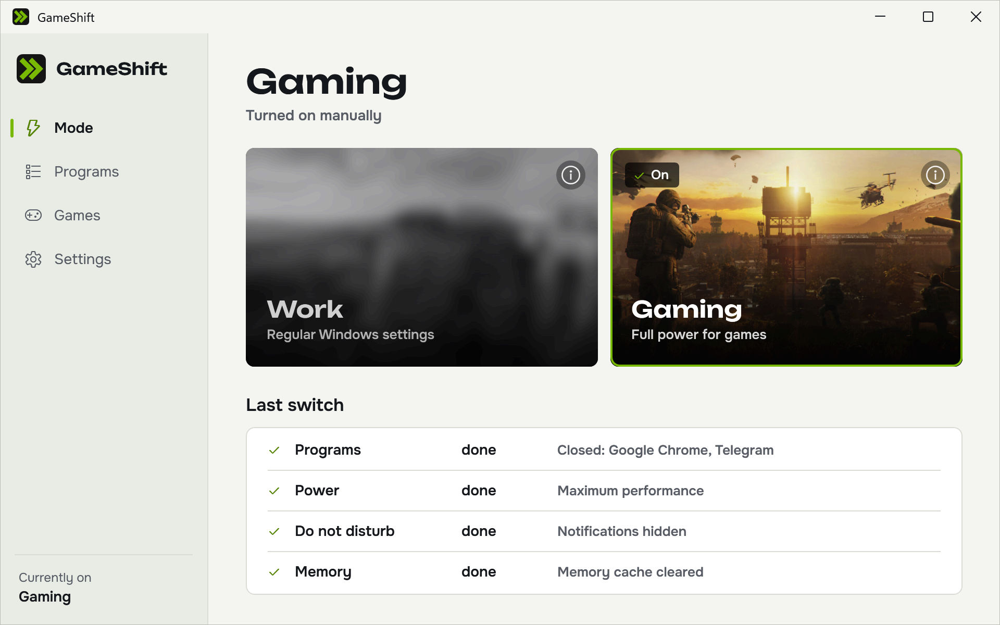
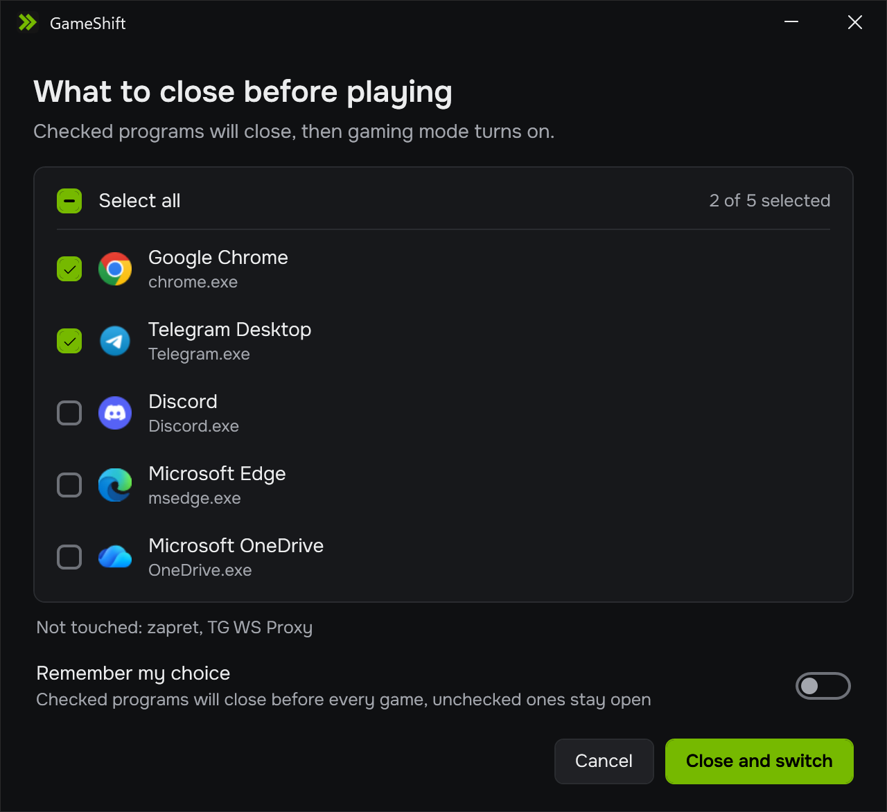

<p align="center">
  
</p>

<h1 align="center">GameShift</h1>

<p align="center">
  One-click Windows game mode: max-performance power plan, closes background apps, silences notifications, frees standby RAM and tunes NVIDIA per-game profiles, then puts everything back when you stop playing.
</p>

<p align="center">
  <a href="https://github.com/officialdasper/GameShift/releases/latest"></a>
  <a href="https://github.com/officialdasper/GameShift/releases"></a>
  <a href="https://github.com/officialdasper/GameShift/actions/workflows/ci.yml"></a>
  <a href="LICENSE"></a>
  
  
</p>

<p align="center">
  English | <a href="README.ru.md">Русский</a>
</p>

<p align="center">
  <a href="https://github.com/officialdasper/GameShift/releases/latest"><b>Download the latest release</b></a>
  <br>
  A single <code>GameShift.exe</code>. No installer, no .NET runtime needed.
</p>

<p align="center">
  
</p>

GameShift is a small tray app for Windows 10 and 11 that works as a game booster. You pick the games once. When one of them starts, GameShift switches the PC to a performance mode: it changes the power plan, closes the background programs you listed, hides notifications and, if you want, clears the standby memory cache. When the game closes, everything returns to how it was. You can also switch by hand from the window or the tray menu.

It is a gaming optimizer for people who want an fps boost in VALORANT, CS2, WARDOGS, Delta Force and other PC games without keeping a pile of tweaks in their head. Think of it as Windows game mode with more levers: power plan, background apps, notifications, memory and NVIDIA profiles.

## Features

- Switches to the "Maximum performance" power plan and restores your previous plan afterwards.
- Hides Windows notifications while you play (Do not disturb).
- Closes background programs by a rule you set for each one: close and restore later, close for good, or leave alone. Before the game you pick what to close in a window with checkboxes (it follows programs you close yourself), and after the game you pick what to reopen. Programs with unsaved work are asked to close and are never force-closed unless you choose to.
- Clears the standby list in RAM before a game. This asks for administrator rights once, when you turn it on.
- Writes performance settings into NVIDIA driver profiles, only for the games in your list: power management, low latency mode, texture filtering, vertical sync and shader cache. One button restores the original values.
- Starts the mode by itself when a game from the list launches, and ends it when the game exits.
- Saves a snapshot of your system to disk before the first change. If the app or the PC crashes in the middle of a session, GameShift offers to put everything back on the next start.
- Lives in the tray, can start with Windows, and opens minimized with the `--tray` flag.
- Dark and light themes, accent colors, Mica and Acrylic window backgrounds on Windows 11.
- Ten interface languages.

## Screenshots

| Games | Settings |
| --- | --- |
|  |  |

Light theme:



Before a game you choose which programs to close:



## Anti-cheat friendly

GameShift is a normal desktop program that changes Windows settings. It does not touch the games. It never:

- opens, reads, injects into or queries game, anti-cheat or launcher processes, including through WMI;
- changes the priority of any process;
- closes processes that live in the Windows folder or in a game folder;
- closes Discord and Telegram workarounds such as zapret (`winws.exe`), GoodbyeDPI and TG WS Proxy;
- installs drivers, emulates key presses or draws an overlay on top of a game;
- sends data over the network. Game covers come from the local Steam cache.

The NVIDIA step edits driver profiles through the official driver API, the same place where NVIDIA Control Panel stores its settings. Apply it while the games are closed.

## Supported games and game scan

Add games three ways: scan for installed games, pick an `.exe` file, or choose from the running processes. The scan reads the libraries of Steam, Epic Games Store, Riot Games, Battle.net, EA app and Ubisoft Connect, so VALORANT, CS2, WARDOGS, Delta Force and the rest of your library are found without typing paths. Any other Windows game works if you point GameShift at its `.exe`.

Steam covers on the tiles are read from your local Steam cache.

## Languages

Russian, English, Ukrainian, German, Spanish, Brazilian Portuguese, French, Polish, Turkish and Simplified Chinese. The language follows Windows by default and can be changed in Settings without a restart.

## FAQ

**Windows SmartScreen says "Windows protected your PC".**
The exe is not code-signed, and Microsoft shows this for any new unsigned program. Click "More info", then "Run anyway". Every release lists SHA256 checksums so you can check the file you downloaded.

**My antivirus flags or quarantines the file.**
Unsigned programs that close other processes and change the power plan sometimes trigger heuristics. Restore the file from quarantine and add it to the exceptions. The source is in this repository, and you can build the exe yourself.

**Why does it ask for administrator rights?**
Only the memory cache feature needs them. Clearing the standby list requires elevation, so GameShift creates a Task Scheduler task, `GameShift\PurgeStandby`, that runs `GameShift.exe` with the highest privileges and no UAC prompt each time. Anyone who can replace the exe can then run code as administrator, so keep `GameShift.exe` in a folder only you and administrators can write to, for example `C:\Program Files\GameShift`, or leave the feature off.

**Do I need an NVIDIA card?**
Only for the NVIDIA block in Settings. On other graphics cards that block is inactive and the rest of GameShift works.

**Do Mica and Acrylic work on Windows 10?**
They need Windows 11 22H2 or newer. On older systems the window stays opaque.

**Where are my settings?**
In `%APPDATA%\GameShift\`: `settings.json`, `snapshot.json` (exists only while a mode is active), `nvidia-backup.json` and `error.log`. Autostart is a value named `GameShift` under `HKCU\Software\Microsoft\Windows\CurrentVersion\Run`.

**How do I uninstall it?**
Turn off "Start with Windows" and the memory cache option in Settings, exit from the tray and delete the exe and the `%APPDATA%\GameShift` folder.

## Build from source

You need the .NET 8 SDK on Windows.

```
dotnet test tests/GameShift.Core.Tests
dotnet publish src/GameShift.App -c Release -r win-x64 --self-contained true -p:PublishSingleFile=true -p:IncludeNativeLibrariesForSelfExtract=true -p:EnableCompressionInSingleFile=true -o publish
```

The result is `publish/GameShift.exe`. The solution has three projects: `GameShift.Core` (logic with no Windows dependencies, covered by xUnit tests), `GameShift.Platform` (power plans, processes, registry, NVIDIA) and `GameShift.App` (WPF window and tray).

## License

[MIT](LICENSE)
