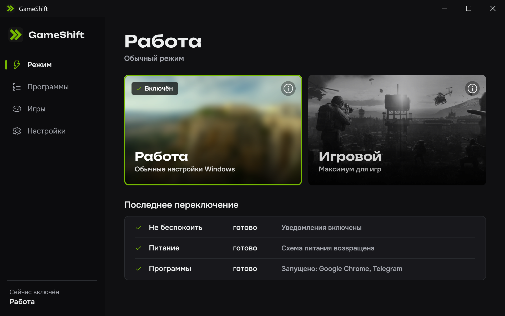
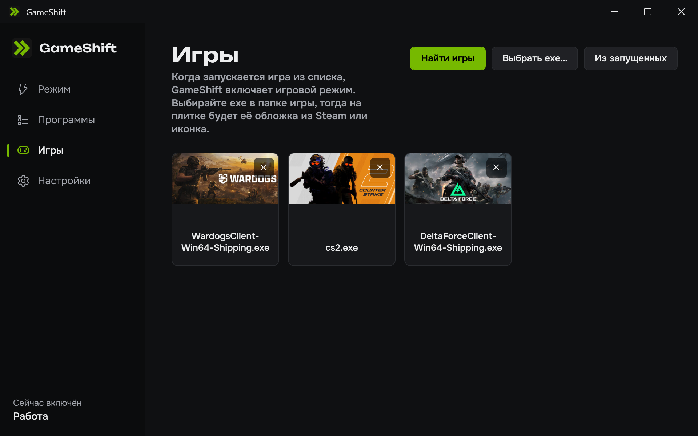
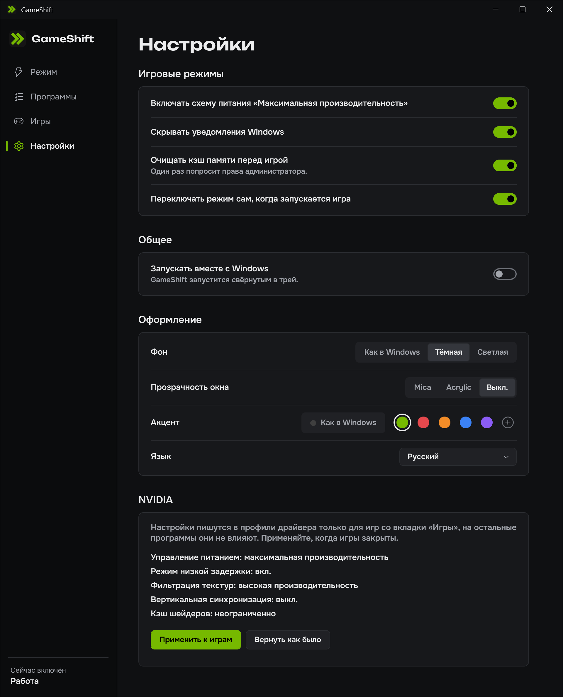
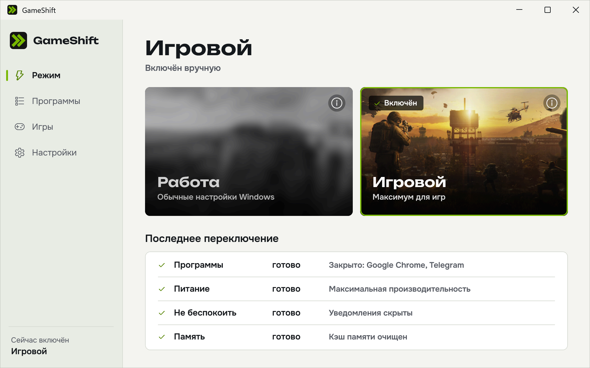
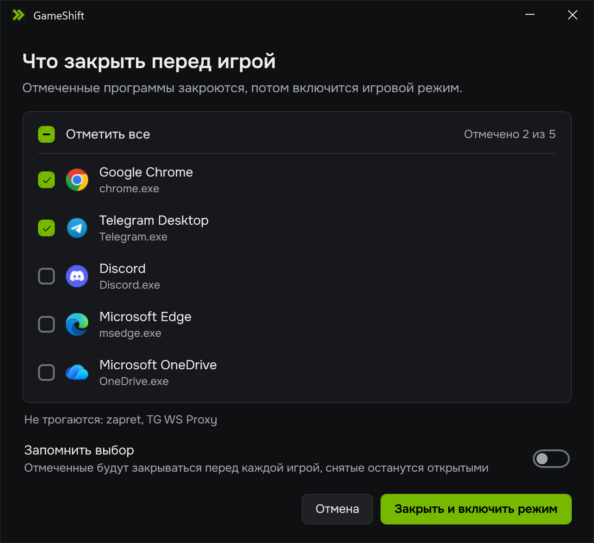

<p align="center">
  
</p>

<h1 align="center">GameShift</h1>

<p align="center">
  Игровой режим Windows в один клик: схема питания «Максимальная производительность», закрытие фоновых программ, тишина от уведомлений, очистка кэша памяти и настройки профилей NVIDIA под каждую игру. Когда вы заканчиваете играть, всё возвращается как было.
</p>

<p align="center">
  <a href="https://github.com/officialdasper/GameShift/releases/latest"></a>
  <a href="https://github.com/officialdasper/GameShift/releases"></a>
  <a href="https://github.com/officialdasper/GameShift/actions/workflows/ci.yml"></a>
  <a href="LICENSE"></a>
  
  
</p>

<p align="center">
  <a href="README.md">English</a> | Русский
</p>

<p align="center">
  <a href="https://github.com/officialdasper/GameShift/releases/latest"><b>Скачать последнюю версию</b></a>
  <br>
  Один файл <code>GameShift.exe</code>. Установщик и .NET не нужны.
</p>

<p align="center">
  
</p>

GameShift это небольшая программа в трее для Windows 10 и 11, игровой бустер для ПК. Вы один раз добавляете свои игры. Когда одна из них запускается, GameShift переводит компьютер в режим производительности: меняет схему питания, закрывает фоновые программы из вашего списка, скрывает уведомления и при желании очищает кэш памяти. После выхода из игры всё возвращается. Режим можно включить и вручную, из окна или меню в трее.

Это игровой режим Windows с большим числом рычагов: схема питания, фоновые программы, уведомления, память и профили NVIDIA. Подходит для ускорения игр и повышения fps в VALORANT, CS2, WARDOGS, Delta Force и других играх, если не хочется каждый раз вручную оптимизировать ПК для игр.

## Возможности

- Включает схему питания «Максимальная производительность» и потом возвращает прежнюю.
- Скрывает уведомления Windows, пока вы играете («Не беспокоить»).
- Закрывает фоновые программы по правилу для каждой: закрыть и вернуть, закрыть насовсем или не трогать. Перед игрой вы отмечаете, что закрыть, в окне с флажками (список сам обновляется, если вы закрываете программы вручную), а после игры выбираете, что открыть обратно. Программам с несохранённой работой сначала предлагается закрыться, принудительно они закрываются только по вашей команде.
- Очищает standby-кэш оперативной памяти перед игрой. Права администратора запрашиваются один раз, при включении функции.
- Записывает настройки производительности в профили драйвера NVIDIA только для игр из вашего списка: управление питанием, режим низкой задержки, фильтрацию текстур, вертикальную синхронизацию и кэш шейдеров. Одна кнопка возвращает исходные значения.
- Включает режим сама, когда запускается игра из списка, и выключает, когда игра закрывается.
- Перед первым изменением пишет на диск снимок системы. Если программа или компьютер упали посреди сессии, при следующем запуске GameShift предложит всё вернуть.
- Живёт в трее, умеет запускаться вместе с Windows, а с ключом `--tray` открывается свёрнутой.
- Тёмная и светлая темы, цвета акцента, фон окна Mica и Acrylic в Windows 11.
- Десять языков интерфейса.

## Скриншоты

| Игры | Настройки |
| --- | --- |
|  |  |

Светлая тема:



Перед игрой вы выбираете, какие программы закрыть:



## Безопасно для античитов

GameShift обычная программа, которая меняет настройки Windows. К самим играм она не прикасается. Она никогда:

- не открывает, не читает, не внедряется и не опрашивает процессы игр, античитов и лаунчеров, в том числе через WMI;
- не меняет приоритет ни одного процесса;
- не закрывает процессы из папки Windows и папок игр;
- не закрывает обход блокировок для Discord и Telegram: zapret (`winws.exe`), GoodbyeDPI и TG WS Proxy;
- не ставит драйверов, не эмулирует нажатия клавиш и не рисует ничего поверх игры;
- не отправляет данные в сеть. Обложки игр берутся из локального кэша Steam.

Шаг NVIDIA меняет профили драйвера через официальный API драйвера, там же, где хранит настройки Панель управления NVIDIA. Применяйте его, пока игры закрыты.

## Поддерживаемые игры и поиск игр

Игры добавляются тремя способами: поиск установленных игр, выбор `.exe` или выбор из запущенных процессов. Поиск читает библиотеки Steam, Epic Games Store, Riot Games, Battle.net, EA app и Ubisoft Connect, так что VALORANT, CS2, WARDOGS, Delta Force и остальная библиотека находятся без ручного ввода путей. Любая другая игра для Windows тоже подойдёт, достаточно указать её `.exe`.

Обложки Steam на плитках берутся из локального кэша Steam.

## Языки

Русский, английский, украинский, немецкий, испанский, португальский (Бразилия), французский, польский, турецкий и китайский (упрощённый). По умолчанию язык берётся из Windows, в настройках его можно сменить без перезапуска.

## Вопросы и ответы

**SmartScreen пишет «Windows защитила ваш компьютер».**
Exe не подписан цифровой подписью, а новые неподписанные программы Microsoft помечает всегда. Нажмите «Подробнее», потом «Выполнить в любом случае». К каждому релизу прилагаются контрольные суммы SHA256, по ним можно сверить скачанный файл.

**Антивирус ругается на файл или убирает его в карантин.**
Неподписанные программы, которые закрывают процессы и меняют схему питания, иногда попадают под эвристику. Верните файл из карантина и добавьте в исключения. Исходный код лежит в этом репозитории, exe можно собрать самостоятельно.

**Зачем нужны права администратора?**
Только для очистки кэша памяти. Для очистки standby-списка нужны повышенные права, поэтому GameShift создаёт задачу планировщика `GameShift\PurgeStandby`: она запускает `GameShift.exe` с наивысшими правами без окна UAC. Значит, тот, кто может подменить exe, получит права администратора. Держите `GameShift.exe` в папке, куда можете писать только вы и администраторы, например в `C:\Program Files\GameShift`, или не включайте эту функцию.

**Нужна ли видеокарта NVIDIA?**
Только для блока NVIDIA в настройках. На других видеокартах он неактивен, остальные функции работают.

**Работают ли Mica и Acrylic в Windows 10?**
Нет, нужна Windows 11 22H2 или новее. В более старых версиях окно остаётся непрозрачным.

**Где хранятся настройки?**
В `%APPDATA%\GameShift\`: `settings.json`, `snapshot.json` (есть только пока включён режим), `nvidia-backup.json` и `error.log`. Автозапуск это значение `GameShift` в `HKCU\Software\Microsoft\Windows\CurrentVersion\Run`.

**Как удалить программу?**
Выключите в настройках «Запускать с Windows» и очистку кэша памяти, выйдите через трей и удалите exe и папку `%APPDATA%\GameShift`.

## Сборка из исходников

Нужен .NET 8 SDK на Windows.

```
dotnet test tests/GameShift.Core.Tests
dotnet publish src/GameShift.App -c Release -r win-x64 --self-contained true -p:PublishSingleFile=true -p:IncludeNativeLibrariesForSelfExtract=true -p:EnableCompressionInSingleFile=true -o publish
```

Результат: `publish/GameShift.exe`. В решении три проекта: `GameShift.Core` (логика без зависимостей от Windows, покрыта тестами xUnit), `GameShift.Platform` (схемы питания, процессы, реестр, NVIDIA) и `GameShift.App` (окно WPF и трей).

## Лицензия

[MIT](LICENSE)
